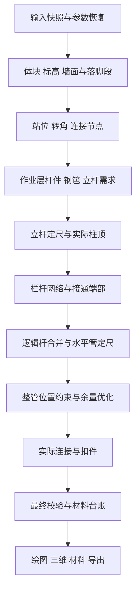

# 计算规则框架设计

状态：**已确认，实施进行中**（2026-11-12）。本文件保留已批准的目标与完整验收范围；实际迁移数量、已通过证据和未完成项以 [实施进度](规则框架实施进度.md) 为准，不能把阶段性交付视为完整完成。原设计基线为 `eb56d31`，冻结对照基线为包含沿墙修复的 `803ba54`。

配套阅读：[现有规则清单](规则清单.md) · [迁移与验收方案](规则框架迁移与验收.md) · [现行计算口径](计算规则.md)。前三份是框架设计；《计算规则》仍描述当前运行行为。设计中的目录、接口、运行日志及命令若标为“拟新增”，现在尚未实现。

## 1. 要解决什么

为每条规则建立稳定身份、适用条件、输入输出、依赖关系、例外和验证证据。新增规则时能回答：它改哪个对象、什么时候运行、会影响谁、发生冲突时谁来判断、最终材料为什么变化。

现有 React / TypeScript / Vite / Three.js 技术栈可承载这个框架，计算继续在本地离线运行。采用**明确的计算阶段 + 有类型的规则模块 + 统一实体关系 + 可检查的变更记录**。几何求交、定尺组合等算法仍是普通函数，框架负责组织、约束和解释它们。

不把任意公式或 JavaScript 放进项目 JSON；不让用户通过开关跳过关键规则；不建立无限重复尝试的推理循环。用户可调的排距、层数等仍是参数，不是规则版本。未来可以添加只读规则目录和“为什么这样算”的查看入口，规则发布仍走代码评审及验收。

### 现状与问题证据

| 当前位置 | 现在的职责 | 框架需要补足的能力 |
| --- | --- | --- |
| `site.ts / calculateSite` | 解析体块、目标层、自动分段、局部测算、高差接通、最终校验 | 明确阶段与阶段产物；避免局部组装和接通后重组装之间遗漏规则 |
| `scaffold.ts / calculateScaffold` | 转角、排柱、纵横杆、钢笆、栏杆候选等集中生成 | 每一类对象有唯一构建责任；明确哪条规则只影响栏杆 |
| `scaffold.ts / finishLayout` | 合并杆件、整理底座、错缝、定尺、扣件、材料 | 同一份最终实体计算材料；合并前后的来源不能丢失 |
| `siteTransitions.ts` | 识别接通端、补杆铺板、打开端栏杆、重算 | 端点以真实节点识别；不能仅靠 `pathSegment` 推断用途 |
| `guardrails.ts / siteWallFit.ts` | 管件移位、通道和墙面避让 | 明确必须满足的约束与尽量改善的目标，防止后一次移位破坏前一次结果 |
| `SiteIssue / LayoutWarning` | 阻断项和提醒，附对象或文本 | 统一规则来源与结构化对象引用，保留现有严重程度 |

第 1 段上层栏杆漏接暴露了三个具体问题：内转角收短后没有本段纵向栏杆，但端柱仍承托邻面栏杆；合并后保留下来的单一归属随方向而变；接通短杆与长杆共用可变对象，合并操作会扩大原碰撞检查范围。框架必须针对这三个问题设合同和测试，不能仅增加一份规则名称列表。

## 2. 范围与规则分类

[规则清单](规则清单.md)登记 45 个业务规则单元。单元按独立业务口径划分，不要求一个单元对应一个文件；一组算法可以共同实现数条规则，但必须声明全部规则 ID。

| 类别 | 做什么 | 例子 | 可以做什么变更 |
| --- | --- | --- | --- |
| 构造规则 | 生成候选实体或确定几何关系 | 双排立柱、内外转角、共享作业层 | 提交新增、区间替换、合并等有类型的提案 |
| 约束规则 | 判断适用性、合法性及结果完整性 | 柱脚承托、不得穿屋、立柱禁用 5 m | 生成拒绝理由或问题；不能暗中修改几何 |
| 优化规则 | 在已确认约束内改善结果 | 少设冗余柱、移开栏杆余量 | 在约定候选集合与目标内选择；无解时按该规则约定回退 |
| 计量规则 | 从最终实体产生材料明细 | 实际扣件、标准管、钢笆片数 | 只写材料台账，不反向增删实体 |
| 边界适配 | 参数、文件及显示口径 | 旧图迁移、手工修正、周长 | 位于输入／输出边界，不参与几何冲突裁决 |

“约束强度”与“界面严重程度”分开：不允许某个候选方案，不一定阻断整个项目。例如立柱不能选 5 m，但当前库存不合适时有既有回退和提醒；框架不能擅自升级成全图阻断。所有既有 issue code、warning 和回退应按清单迁移。

## 3. 目标执行阶段

以下是目标结构，**不是立即重排现有代码的指令**。先用适配器保留当前执行顺序；只有逐阶段等价验收通过后，才替换对应算法。任何新的几何结果都须作为业务变更另行说明。



| 阶段 | 输入与产物 | 写入责任与不能做的事 |
| --- | --- | --- |
| S0 输入快照 | 原项目、已恢复参数 → 不可变输入及版本标识 | 兼容旧字段；不改用户原坐标，不把手工材料增量并入几何参数 |
| S1 场景事实 | 输入 → 真实轮廓、父子标高、逐段全局层号、墙向、落脚区间 | 先判支承面再算当地净高；保留自动目标与手选面层数的不同语义 |
| S2 站位与连接 | 场景事实 → 柱对、角柱、端节点、跨界意图 | 处理纵距、短边及窄巷；连接节点属于实体，不属于“第几段”标签 |
| S3 工作架体 | 节点 → 作业层纵横杆、扫地杆、钢笆覆盖、底座、立杆高度及栏杆候选 | 工作层纵杆和栏杆分开；明确所有跨界工作杆和共用关系，不因栏杆收短改动铺板 |
| S4 立杆组装 | 最终站位及现行高度规则 → 标准立杆、错缝关系、实际柱顶 | 延用现行错缝邻接范围和选择顺序；不为承托某条栏杆擅自加高立杆 |
| S5 防护网络 | 候选栏杆、真实节点、实际柱顶、共有层 → 防护边界和端部开闭 | 内外交叉、实墙、短转角借接、端栏杆局部移除在这里解决；不删除作业层纵杆 |
| S6 合并与组管 | 确定的逻辑杆 → 共用杆及水平标准管 | 合并保留所有来源和各区间用途；不再次求解或缩短已确定的立杆 |
| S7 实体定位 | 标准管、墙体、连接点、通道 → 最终实体坐标 | 保持整根规格及必需连接，硬约束先于优化；接头位置由最终管段端点推导，扣件实体在S8创建 |
| S8 连接计量 | 最终实体、连接拓扑 → 实际十字扣、对接扣 | 按真实杆件对去重；不把填芯交叉虚构为已建模的转向扣 |
| S9 最终输出 | 最终实体 → 校验结果、材料台账、兼容 `SiteLayout` | 校验不能再移动实体；计量不能另造几何；原阻断与提醒口径保留 |

### 有限反馈，避免循环

选管等无状态算法可由不同阶段复用：S1 求墙距时根据库存计算横管余量，调用与 S01 相同的纯选管函数，不读取 S4/S6 尚未生成的标准管实体。算法复用不构成反向阶段依赖；未来注册表须区分读取原始参数、调用纯函数与读取前序产物。

- 钢笆铺板层和栏杆候选在立杆定尺前可求；栏杆是否有实际柱顶承托在 S4 后确定。支持不足按原规则舍弃并告警，不反复升柱、删栏杆、降柱。
- 某条未来规则需要新增承托柱时，必须作为 S2 规则设计，而不是让 S7 临时补柱后无限重跑。
- 开发期间如果 S5 才发现 S2 缺少必需节点，返回可定位的阶段合同失败，不能伪造节点。是否新增构造由业务确认；与当前“允许不可避免的栏杆余量侵入”无关。
- 全局同层接通意图应在 S2/S3 表达；现有适配器仍可在局部组装后重建。迁移期间记录重建原因与范围，不能宣称已经完成一次性全局求解。

## 4. 统一对象：来源、用途和几何分开

保留 `Site`、`ScaffoldMember`、`PipeSegment` 等现有公共输出，新增框架内部对象后通过适配器输出旧结构。内部建议如下：

| 对象 | 身份与关键字段 | 用途 |
| --- | --- | --- |
| SourceSection | 已保存 `S1` 等 ID、原始端点、编辑组、层数语义 | 用户笔画；显示“第 1 段”的排序只是标签 |
| SupportSpan | source ID、来源区间、surface ID、底标高 | 一笔跨多个落脚面后的实体区间 |
| Station / SupportNode | 站位 ID、双排位置、底面、柱角色、邻接 | 判断真实连接与承托，不能用浮点字符串碰巧相同代替全部拓扑 |
| LiftConnection | 两端 node ID、全局层号、工作杆与防护需求 | 工作层连通和栏杆连通是不同事实，分别验证 |
| LogicalMember | 几何、节点、层、角色集合、多个来源区间 | 合并后仍能识别“这部分是端封口、那部分是邻面纵栏杆” |
| PhysicalPipe | member ID、标准规格、序号、实体端点、接头 | 三维与采购规格的唯一依据 |
| Contribution | 最终实体 ID、类别、规格、数量、规则来源 | 每根标准管／每只扣件／每片钢笆可追溯的材料贡献 |

内部 ID 在同一输入、同一规则版本下确定；根据来源、分段区间、角色、节点生成，避免遍历计数作为唯一依据。编辑后区间变化可产生新 ID，不承诺跨所有编辑永久不变；以 `derivedFrom` / `replacedBy` 维护谱系。旋转、平移验收比较规范化几何与来源集合，不以内部 ID 必须相同为前提。

**合并不覆盖来源。** `origins` 是来源集合；`segments` 记录沿杆的用途区间。现有单个 `pathSegment` 仅作为兼容显示索引，不再用于“整根是否可删”的业务判定。删除某一用途区间后重新求剩余支承段；不能按保留下来的段号删除整根共用杆。

**不可变快照。** 接通区的验证范围在创建时固定，合并长杆返回新对象；禁止桥接验证、渲染、材料组装持有同一可变成员并各自修改。每阶段只发布已提交的产物。

### 数值合同

沿用目前的单位和舍入位置：场景米制；层高边界用毫米；旧路径适配 50 px/m；钢笆覆盖计算保留现有细精度再汇总。不能在迁移中统一把全部中间顶点取整到毫米，造成面积变化。规则声明使用的容差策略，不能各自增加不明来源的 `epsilon`。序列化、业务边界比较、几何积分三种精度用途分开。

## 5. 规则包合同（拟新增）

拟放置在 `src/domain/rules/`。每个规则包包含元数据、求值函数、合同测试及例外关系。一个业务编号可以有多个阶段步骤，例如 P05 分为 `P05.working`（S3）与 `P05.guard`（S5），共同继承 P05 的修订和确认来源；不能把业务编号重复注册为两条不同规则。依赖图以执行步骤为节点，业务关系仍以规则编号表达。建议接口草案如下；`FactsByPhase`、`ProposalByPhase`、`DeepReadonly` 由阶段产物及只读类型定义，不能在实现中退化为 `any`。

```ts
type Phase = 'S0' | 'S1' | 'S2' | 'S3' | 'S4' | 'S5' | 'S6' | 'S7' | 'S8' | 'S9'
type RuleKind = 'construction' | 'constraint' | 'optimization' | 'measurement' | 'adapter'
type RuleRelation = {
  target: string
  kind: 'requires' | 'refines' | 'exceptionOf' | 'incompatibleWith'
  condition: string       // 对应有类型谓词的注册名，不是执行字符串
  reason: string
  caseIds: readonly string[]
}
type RuleDefinition = {
  id: string             // 例如 P05；永不挪作另一条业务规则
  revision: number
  status: 'draft' | 'active' | 'retired'
  title: string
  relations: readonly RuleRelation[]
  source: readonly string[]   // 用户确认、现行规则章节、实现依据
  caseIds: readonly string[]
}
type RuleStep<P extends Phase> = {
  id: string             // 例如 P05.guard；执行步骤唯一标识
  ruleId: string         // 引用 RuleDefinition，继承其修订和状态
  phase: P
  kind: RuleKind
  after: readonly string[]   // 前置步骤 ID，不能倒向后续阶段
  reads: readonly string[]
  writes: readonly string[]
  evaluate(facts: DeepReadonly<FactsByPhase[P]>): RuleOutcome<ProposalByPhase[P]>
}
type RuleOutcome<T> =
  | { status: 'not-applicable'; reasonCode: string }
  | { status: 'proposed'; proposals: readonly T[]; reasons: readonly string[] }
  | { status: 'rejected'; diagnostics: readonly RuleDiagnostic[] }
```

实现时 `RuleDiagnostic` 包含 rule ID/revision、阶段、问题 code、严重程度、源段／实体 ID、结构化事实和显示消息。采用深只读输入类型；测试环境冻结输入并检测越权写。生产环境由可信的静态 TypeScript 模块运行，**这不是执行不可信插件的安全隔离器**。

提案按实体种类区分，例如 `AddPost`、`ConnectLift`、`ReplaceGuardRange`、`MergeMembers`、`PlaceStock`、`AddMaterialContribution`。不存在任意 `set(path, value)`：栏杆规则拿不到删除钢笆／工作杆的提案类型。提案包含输入修订号、目标实体 ID、预期旧状态；过期引用不能提交。

运行器先检查依赖、适用条件，再求值、收集提案、检查冲突、原子提交阶段产物。相同提案按业务键去重；重复运行不能多出一套扣件。同阶段按 `after` 拓扑分批：每批读取同一只读快照，统一检查提案；后继步骤读取批次提交到私有草稿的结果。仅当整个阶段通过时发布产物，失败则丢弃该阶段草稿，不回写前一阶段；没有依赖关系的竞争写入仍须判定冲突，不能靠任意遍历顺序覆盖。因冲突拒绝的阶段不发布半成品材料结果。失败草图仍可保存；上一次成功结果若展示必须标为旧结果，不能冒充当前测算。

### 关系与顺序

- `requires` 表示业务前提，实现时须映射到具体步骤的 `after` 与产物读取，形成有向无环图；缺少规则、缺少步骤、循环依赖、跨阶段倒序依赖在开发检查中失败。
- `refines` 补充默认规则，例如特定屋顶边界对一般排站的细化，不等同于无条件覆盖。
- `exceptionOf` 必须写出适用条件、确认来源、保留的不变量、回退和回归案例。例外默认只影响声明的字段／用途区间。
- `incompatibleWith` 表示某规则集不能同时启用；参数触发的局部冲突还须在求值时检查。
- 不用“大数字优先级”掩盖竞争写入。同一目标同一字段的相同结果合并；不同结果只有在明确的细化／例外合同满足时才允许覆盖，否则报告冲突，业务含义不确定时先询问用户。
- 静态声明可以查缺依赖、重叠写入和错误阶段，不能自动证明两条业务规则语义不冲突。仍要做组合回归和人工业务确认。

实施补充（2026-11-13）：`RuleDefinition.relations` 已接入有类型的注册表。`requires` 逐项绑定具体步骤；发布审计检查全部跨规则 `after` 是否登记，业务编号本身不做循环判定（同一业务规则可分阶段执行）。`refines`／`exceptionOf` 通过关系编号和具名谓词绑定实际提案目标，必须列出保留不变量、确认来源、拒绝回退及案例。只有运行时谓词实际接受了竞争写入，诊断才记录 `appliedRelations`。`incompatibleWith` 同时启用时在编译合同阶段失败。

## 6. 约束与优化怎样共同工作

以标准管避让为例：先建立保持完整规格、覆盖逻辑段和连接点、遵守墙体约束的可行位置集合，再在其中最小化通道侵入；同分取移动量最小。没有更优方案则保留原可用位置。两端受限而剩余侵入不能消除时按已确认口径保留，不截管、不增加该项出量阻断。

同时写 `PhysicalPipe.position` 的跨界余量、避墙、通道优化规则，在目标框架中提交约束／目标给**同一个定位器**，不各自移动后互相覆盖。现有先后调用在兼容适配器里保留；统一定位器若产生不同位置，必须进入迁移差异评审，不能以“更优”为由静默改变图纸。

| 规则组合 | 明确处理 |
| --- | --- |
| P03 内交叉收短 vs M03 工作纵杆长度 | 只修改防护用途区间；M03 不变 |
| P03 收短 vs P05 高差连接 | 通过真实端柱及相邻面栏杆连接；不能要求本段仍保留一根同向栏杆 |
| P06 打开端栏杆 vs M08 合并 | 按用途区间处理，不依赖合并后单一段号 |
| G05 屋顶连续排柱 vs G08 转角删柱 | 保留承担跨界连接的完整端柱对，远端共用角柱不移 |
| P08 通道优化 vs S04 避墙 | 避墙约束优先；不能完全消除的通道侵入允许存在 |
| S02 禁用 5 m 立柱 vs S03 错缝优化 | 禁用库存不进入错缝候选；维持现行无解提示／回退 |
| G06 窄巷接柱 vs G07 计算分组 | 整组／独立编辑不应成为物理连接的分界 |

## 7. 第 1 段实例：怎样解释一次结果

原始双屋图在第 1 段有地面站位 `(5.05, -2.50)` 与 B2 顶面站位 `(6.85, -2.50)`，排距 0.75 m；外排对应 `z = -3.25 m`。共同作业层为 5.64 / 7.52 m。

1. G05 记录跨界柱距 1.80 m，G08 保留必需端柱；S4 得到其真实可承托柱顶。
2. P03 把地面短内角的防护收至角柱。本段可能不剩独立纵向栏杆，但 SupportNode 及相邻面防护边仍存在。
3. P05 从节点防护邻接关系找到 6.58 / 8.46 / 9.70 m 三个连接标高，分别提交连续防护边；不能仅把工作层设为“已接通”。
4. P06 只移除屋顶接入口及地面节点处变成通道内部的横向封口区间。邻面的外侧纵栏杆仍在；M08 合并保留这些来源。
5. S6/S7 选标准管并定位，S8 按最终连接产生扣件，S9 检查实际管覆盖从 `x = 5.05` 连到 `x = 9.25` 无断口。

拟新增的解释记录包括：`ruleId/revision`、原因码、输入节点、变更前后区间、输出成员 ID、关联 case ID。点击实体可追溯到“哪条规则、哪些输入、哪条例外”；默认只保留必要谱系，详细逐步日志按需启用。日志是诊断证据，不作为几何输入重新执行。

## 8. 版本、存档与结果一致性

- 区分文件格式版本（现在 0.7／OA 0.6）、规则集版本、单规则修订、引擎构建版本。更换框架不意味着立即升级文件格式。
- 一个计算会话固定一份参数快照与规则集清单，不能计算中途热替换规则。清单含有效规则及修订、精度配置、实现构建标识。
- 拟新增 `calculationMeta` 放在框架结果及诊断导出中，包含 input fingerprint、ruleset fingerprint、engine revision。以后若写入场景文件，须先设计读取兼容；OA 0.6 导出保持已有白名单字段。
- 当前历史主要保存输入和手工修正，不能宣称已能永久重放所有旧引擎。设计建议：保存时附规则集标识；旧记录重算若版本不同要区分“原记录”与“当前重算”。是否长期内置旧引擎及旧材料结果快照，作为后续存档产品需求另行确认，不阻塞等价框架迁移。
- 人工修正只作用于最终材料显示／导出，永不改变构件和计算台账；数量未知仍为 `null/--`，不是零。

## 9. Web、平板与性能

用户补充（2026-11-13）：200段不属于实际使用规模，移出性能验收，保留其正确性回归。其余代表场景仍按耗时与峰值RSS严格小于冻结旧版3倍验收。

框架不改变现有新拟态界面和操作方式。编辑器、三维、材料、CSV 仍读取同一个计算结果；未来解释入口复用现有对象面板／零件详情，不在画布堆出规则列表。

- 默认一次完整计算；先保证等价，后做增量缓存。拖动只预览、提交后测算的操作口径保留。
- 注册表及依赖图在模块初始化时编译一次。运行时不解析公式、不扫描 Markdown，不加载远程规则。
- 不为每条规则深复制整个场景；采用阶段内受控构建、提交后只读及结构共享。详细日志默认关闭，实体谱系采用 ID 集合和区间，不存整个历史快照。
- 参数缓存依赖：修改高度影响父子标高→落脚／层→连接→材料；修改排距影响墙距／站位／杆件／管件；修改库存影响立杆、横管外伸及由此决定的墙距，不能只刷新材料；手工增量只刷新输出；相机及标注缩放不触发计算。
- 后续如引入 Web Worker，仍复用同一纯计算入口。任务带 input revision，返回旧结果时丢弃，不能覆盖更新的图纸。未完成旧新结果对照前不同时引入 Worker 与规则重构。
- 平板验收须区分浏览器尺寸／模拟触摸与安卓真机的耗时、内存、WebView 行为；具体门槛见迁移方案。设计不依赖联网服务。

## 10. 目录和日常维护（拟新增）

```text
src/domain/rules/
  contracts.ts          # 规则、阶段、提案、问题、版本
  catalog.ts            # 注册表；不从散落的数字优先级决定行为
  pipeline.ts           # 依赖检查、求值、冲突检测、阶段提交
  facts/                # 节点、来源、用途区间、只读阶段产物
  policies/             # 按场景、站位、构件、防护、库存、计量组织
  reducers/             # 每类实体的唯一修改入口
  diagnostics/          # 解释链、差异报告、规则集标识
  adapters/             # 现行内核与 SiteLayout / OA 兼容边界
```

本轮的 Markdown 规则清单是盘点依据。实施后由有类型注册表生成规则索引及依赖图，业务解释仍由《计算规则》维护；检查器验证引用双向存在，避免目录、代码、文档三份名单长期漂移。

新增／修改流程：找到规则 ID → 写固定输入与期望 → 标明被细化规则、依赖、写集合与适用范围 → 对业务冲突先询问 → 修改求值与 reducer → 运行单条、组合及全量验收 → 审阅差异及性能 → 更新版本、文档、规则集清单 → 提交发布。修 bug 不得顺手覆盖未确认的业务口径。

## 11. 设计完成与实施完成的界线

本设计交付：现行规则可定位、目标阶段及对象合同明确、冲突处理可执行、有最近实际 bug 的端到端示例、迁移顺序和验收门槛明确。**不代表规则运行器或新内核已经交付。** 实施须按配套迁移方案逐项提供证据，最终覆盖全部登记的计算规则及输入输出边界，不能只给旧函数加元数据就宣称迁移完成。
