# 规则索引与依赖图

> 自动生成：`npm run rules:docs`。请修改有类型注册表或步骤声明，不要手工修改本文件。`npm run rules:docs -- --check` 和 `npm run audit:rules` 会拒绝过期内容。

当前有 45 个业务规则、65 个注册执行步骤。业务解释、确认过的例外及固定手算见[计算规则](计算规则.md)、[规则清单](规则清单.md)和[验收矩阵](qa/规则验收矩阵.md)。

## 业务规则

| 规则 / 修订 | 状态 / 实现 | 业务说明 | 执行步骤 | 实现来源 | 验证索引 |
| --- | --- | --- | --- | --- | --- |
| C01 / 1 | active / native | 十字扣按真实相连成员对计一次；填芯只在实际横杆交点计；移走的柱不计虚扣 | `S6 C01.contacts` `S8 C01.actual` | [src/domain/rules/policies/connections.ts](../src/domain/rules/policies/connections.ts) [src/domain/rules/connections.ts](../src/domain/rules/connections.ts) | `T05` `T12` [src/domain/rules/connections.test.ts](../src/domain/rules/connections.test.ts) [src/domain/scaffold.test.ts](../src/domain/scaffold.test.ts) |
| C02 / 1 | active / native | 每个物理管接头一只对接扣；位置与方向跟随真实组管 | `S8 C02.splices` | [src/domain/rules/connections.ts](../src/domain/rules/connections.ts) [src/domain/rules/facts/fittings.ts](../src/domain/rules/facts/fittings.ts) | `T05` `T10` `T12` [src/domain/rules/stock.test.ts](../src/domain/rules/stock.test.ts) [src/domain/scaffold.test.ts](../src/domain/scaffold.test.ts) |
| C03 / 1 | active / native | 转向扣和未建模剪刀撑／连墙件不凭空生成数量；待定保持 null/-- | `S9 C03.unknown` | [src/domain/rules/materials.ts](../src/domain/rules/materials.ts) [src/domain/rules/policies/materials.ts](../src/domain/rules/policies/materials.ts) [src/domain/rules/facts/materialLedger.ts](../src/domain/rules/facts/materialLedger.ts) | `T05` `T06` `T12` `T14` [src/domain/rules/materials.test.ts](../src/domain/rules/materials.test.ts) [src/domain/rules/facts/memberUses.test.ts](../src/domain/rules/facts/memberUses.test.ts) |
| G01 / 2 | active / native | 共线墙面合并识别，地面沿墙笔画不依赖 automatic 标记，按毫米容差识别并向真实外侧偏移；默认距墙 0.30 m，横管余量可能增加净空 | `S1 G01.walls` | [src/domain/rules/policies/routing.ts](../src/domain/rules/policies/routing.ts) [src/domain/rules/routing.ts](../src/domain/rules/routing.ts) | `T03` `T07` `T08` `T13` [src/domain/rules/routing.test.ts](../src/domain/rules/routing.test.ts) [src/domain/siteEditing.test.ts](../src/domain/siteEditing.test.ts) |
| G02 / 1 | active / native | 自动笔画按整个双排和底座占用范围识别顶面并分段；手选面不自动换面 | `S1 G02.support` `S2 G02.publish` | [src/domain/rules/policies/routing.ts](../src/domain/rules/policies/routing.ts) [src/domain/rules/routing.ts](../src/domain/rules/routing.ts) | `T03` `T07` `T08` `T13` [src/domain/rules/routing.test.ts](../src/domain/rules/routing.test.ts) [src/domain/siteEditing.test.ts](../src/domain/siteEditing.test.ts) |
| G03 / 1 | active / native | 纵距为上限，等分排站；距角位 ≤0.25 m 可整站协调，不能超纵距或改原端点 | `S2 G03.align` `S2 G03.grid` | [src/domain/rules/topology.ts](../src/domain/rules/topology.ts) [src/domain/rules/policies/topology.ts](../src/domain/rules/policies/topology.ts) | `T04` `T07` `T08` [src/domain/rules/topology.test.ts](../src/domain/rules/topology.test.ts) [src/domain/scaffold.test.ts](../src/domain/scaffold.test.ts) |
| G04 / 1 | active / native | 两侧落地的屋顶中段从两侧端站协调排跨，减少屋顶冗余柱对 | `S2 G04.balance` | [src/domain/rules/policies/routing.ts](../src/domain/rules/policies/routing.ts) [src/domain/rules/routing.ts](../src/domain/rules/routing.ts) | `T03` `T07` `T08` `T13` [src/domain/rules/routing.test.ts](../src/domain/rules/routing.test.ts) [src/domain/siteEditing.test.ts](../src/domain/siteEditing.test.ts) |
| G05 / 1 | active / native | 单侧屋顶接入口从低侧端柱按纵距定位，远端共用屋顶转角保留；短面保留可行短跨 | `S2 G05.anchor` | [src/domain/rules/policies/routing.ts](../src/domain/rules/policies/routing.ts) [src/domain/rules/routing.ts](../src/domain/rules/routing.ts) | `T03` `T07` `T08` `T13` [src/domain/rules/routing.test.ts](../src/domain/rules/routing.test.ts) [src/domain/siteEditing.test.ts](../src/domain/siteEditing.test.ts) |
| G06 / 1 | active / native | 相向墙末端窄巷满足一套双排净空但放不下两套时，低架接高架已有柱对，显示实际墙距 | `S1 G06.clearance` | [src/domain/rules/policies/routing.ts](../src/domain/rules/policies/routing.ts) [src/domain/rules/routing.ts](../src/domain/rules/routing.ts) | `T03` `T07` `T08` `T13` [src/domain/rules/routing.test.ts](../src/domain/rules/routing.test.ts) [src/domain/siteEditing.test.ts](../src/domain/siteEditing.test.ts) |
| G07 / 1 | active / native | 同落脚面和相连关系计算分组，自动段可有不同层数；编辑组不是物理边界 | `S2 G07.components` | [src/domain/rules/groups.ts](../src/domain/rules/groups.ts) [src/domain/rules/policies/groups.ts](../src/domain/rules/policies/groups.ts) | `T04` `T08` `T11` [src/domain/rules/groups.test.ts](../src/domain/rules/groups.test.ts) [src/domain/rules/facts/memberUses.test.ts](../src/domain/rules/facts/memberUses.test.ts) |
| G08 / 1 | active / native | 内角合柱、外角延伸补柱、共点取较高柱；闭合首尾同规则；必需跨界端柱对保留 | `S2 G08.corners` `S3 G08.componentPosts` `S3 G08.sharedPosts` | [src/domain/rules/posts.ts](../src/domain/rules/posts.ts) [src/domain/rules/policies/posts.ts](../src/domain/rules/policies/posts.ts) [src/domain/rules/components.ts](../src/domain/rules/components.ts) [src/domain/rules/topology.ts](../src/domain/rules/topology.ts) [src/domain/rules/policies/topology.ts](../src/domain/rules/policies/topology.ts) [src/domain/rules/policies/components.ts](../src/domain/rules/policies/components.ts) | [src/domain/rules/facts/memberHistory.test.ts](../src/domain/rules/facts/memberHistory.test.ts) `T05` `T12` [src/domain/rules/posts.test.ts](../src/domain/rules/posts.test.ts) [src/domain/scaffold.test.ts](../src/domain/scaffold.test.ts) |
| G09 / 1 | active / native | 连续短折返可借相邻已有延伸；冗余端柱受 0.25 m、纵距、交点支承条件限制 | `S2 G09.retain` | [src/domain/rules/topology.ts](../src/domain/rules/topology.ts) [src/domain/rules/policies/topology.ts](../src/domain/rules/policies/topology.ts) | `T04` `T07` `T08` [src/domain/rules/topology.test.ts](../src/domain/rules/topology.test.ts) [src/domain/scaffold.test.ts](../src/domain/scaffold.test.ts) |
| I01 / 1 | active / boundary | 缺失参数补默认，保留明确旧值；旧 height、rowCount 迁移；库存补入 5 / 3.5 m | 纯策略或输入输出边界，见实现来源 | [src/domain/rules/boundaries/parameters.ts](../src/domain/rules/boundaries/parameters.ts) | `T01` `T14` [src/domain/project.test.ts](../src/domain/project.test.ts) [src/domain/scaffold.test.ts](../src/domain/scaffold.test.ts) |
| I02 / 1 | active / native | 场景米制、旧图 50 px/m；层边界按毫米；覆盖细坐标保留 6 位精度 | 纯策略或输入输出边界，见实现来源 | [src/domain/rules/facts/precision.ts](../src/domain/rules/facts/precision.ts) [src/domain/polygons.ts](../src/domain/polygons.ts) | `T02` `T04` `T05` [src/domain/rules/facts/precision.test.ts](../src/domain/rules/facts/precision.test.ts) [src/domain/site.test.ts](../src/domain/site.test.ts) |
| I03 / 1 | active / native | 正交闭合真实轮廓、凹口留空；叠放完整支承、无循环，子体块随父标高变化 | `S1 I03.resolve` | [src/domain/rules/policies/blocks.ts](../src/domain/rules/policies/blocks.ts) [src/domain/rules/scene.ts](../src/domain/rules/scene.ts) | `T03` `T13` [src/domain/site.test.ts](../src/domain/site.test.ts) |
| I04 / 1 | active / native | 首层严格高于当地底面，取连续指定全局层；目标已过时新段至少一层并提示 | `S1 I04.sectionFacts` | [src/domain/rules/policies/levels.ts](../src/domain/rules/policies/levels.ts) | [S1；S测 3.759/3.760/3.761 与目标边界](../S1；S测 3.759/3.760/3.761 与目标边界) |
| I05 / 1 | active / native | 自动段按最低地面目标层；手选面的独立层数按当地首层；followGlobal 决定是否跟随 | `S1 I05.targets` | [src/domain/rules/policies/levels.ts](../src/domain/rules/policies/levels.ts) | `S1；S测单面独立、全局目标、存档` |
| M01 / 1 | active / native | 始终两排立杆；填芯数量只改变钢笆纵向支承杆 | `S3 M01.rows` | [src/domain/rules/frameRows.ts](../src/domain/rules/frameRows.ts) [src/domain/rules/policies/frameRows.ts](../src/domain/rules/policies/frameRows.ts) | `T05` `T12` [src/domain/rules/frameRows.test.ts](../src/domain/rules/frameRows.test.ts) [src/domain/scaffold.test.ts](../src/domain/scaffold.test.ts) |
| M02 / 1 | active / native | 当地顶层高度加固定延伸；带栏杆排与开口端按现有较高柱需求，实际定尺另算 | `S3 M02.heights` | [src/domain/rules/heights.ts](../src/domain/rules/heights.ts) [src/domain/rules/policies/heights.ts](../src/domain/rules/policies/heights.ts) | `T05` `T12` [src/domain/rules/heights.test.ts](../src/domain/rules/heights.test.ts) [src/domain/scaffold.test.ts](../src/domain/scaffold.test.ts) |
| M03 / 1 | active / native | 纵杆和填芯按现有转角范围齐长；横杆不加管端外伸；成功转角省其横杆 | `S3 M03.rows` `S3 M03.workingBands` | [src/domain/rules/bands.ts](../src/domain/rules/bands.ts) [src/domain/rules/policies/bands.ts](../src/domain/rules/policies/bands.ts) [src/domain/rules/frameRows.ts](../src/domain/rules/frameRows.ts) [src/domain/rules/policies/frameRows.ts](../src/domain/rules/policies/frameRows.ts) | `T05` `T12` [src/domain/rules/bands.test.ts](../src/domain/rules/bands.test.ts) [src/domain/scaffold.test.ts](../src/domain/scaffold.test.ts) |
| M04 / 1 | active / native | 扫地杆从当地底面算，只有两排普通纵杆及横杆，无钢笆／填芯 | `S3 M04.sweep` | [src/domain/rules/bands.ts](../src/domain/rules/bands.ts) [src/domain/rules/policies/bands.ts](../src/domain/rules/policies/bands.ts) | `T05` `T12` [src/domain/rules/bands.test.ts](../src/domain/rules/bands.test.ts) [src/domain/scaffold.test.ts](../src/domain/scaffold.test.ts) |
| M05 / 1 | active / native | 钢笆按选定规格及 0.10 m 搭接计整片；铺板间隔按全局层；外角补角片 | `S3 M05.panels` | [src/domain/rules/decks.ts](../src/domain/rules/decks.ts) [src/domain/rules/policies/decks.ts](../src/domain/rules/policies/decks.ts) | [src/domain/rules/facts/partHistory.test.ts](../src/domain/rules/facts/partHistory.test.ts) `T05` `T12` [src/domain/rules/decks.test.ts](../src/domain/rules/decks.test.ts) [src/domain/scaffold.test.ts](../src/domain/scaffold.test.ts) |
| M06 / 1 | active / native | 同层重叠覆盖只计一次；内角归进段，裁片不按碎面数重复计片，不留孔洞 | `S3 M06.componentCoverage` `S3 M06.coverage` | [src/domain/rules/decks.ts](../src/domain/rules/decks.ts) [src/domain/rules/policies/decks.ts](../src/domain/rules/policies/decks.ts) [src/domain/rules/components.ts](../src/domain/rules/components.ts) [src/domain/rules/policies/components.ts](../src/domain/rules/policies/components.ts) | [src/domain/rules/facts/partHistory.test.ts](../src/domain/rules/facts/partHistory.test.ts) `T05` `T12` [src/domain/rules/decks.test.ts](../src/domain/rules/decks.test.ts) [src/domain/scaffold.test.ts](../src/domain/scaffold.test.ts) |
| M07 / 1 | active / native | 每柱对一根与横管等长的槽钢；转角单方向；无柱或支承被更完整底座承接时去重 | `S3 M07.baseCandidates` `S3 M07.componentBases` `S3 M07.supportingBases` | [src/domain/rules/bases.ts](../src/domain/rules/bases.ts) [src/domain/rules/policies/bases.ts](../src/domain/rules/policies/bases.ts) [src/domain/rules/components.ts](../src/domain/rules/components.ts) [src/domain/rules/policies/components.ts](../src/domain/rules/policies/components.ts) | [src/domain/rules/facts/partHistory.test.ts](../src/domain/rules/facts/partHistory.test.ts) `T05` `T12` [src/domain/rules/bases.test.ts](../src/domain/rules/bases.test.ts) [src/domain/scaffold.test.ts](../src/domain/scaffold.test.ts) |
| M08 / 1 | active / native | 同高同线同用途直杆合并；纵横共用保留 roles；只组装、渲染、计量一次 | `S6 M08.shared` | [src/domain/rules/sharedMembers.ts](../src/domain/rules/sharedMembers.ts) [src/domain/rules/policies/sharedMembers.ts](../src/domain/rules/policies/sharedMembers.ts) | [src/domain/rules/facts/memberHistory.test.ts](../src/domain/rules/facts/memberHistory.test.ts) `T04` `T08` `T11` [src/domain/rules/groups.test.ts](../src/domain/rules/groups.test.ts) [src/domain/rules/facts/memberUses.test.ts](../src/domain/rules/facts/memberUses.test.ts) |
| O01 / 1 | active / native | 钢管、扣件、片数、覆盖面积、槽钢从最终实体统一汇总；房屋不计材料 | `S9 O01.quantities` | [src/domain/rules/materials.ts](../src/domain/rules/materials.ts) [src/domain/rules/policies/materials.ts](../src/domain/rules/policies/materials.ts) [src/domain/rules/facts/materialLedger.ts](../src/domain/rules/facts/materialLedger.ts) | `T05` `T06` `T12` `T14` [src/domain/rules/materials.test.ts](../src/domain/rules/materials.test.ts) [src/domain/rules/facts/memberUses.test.ts](../src/domain/rules/facts/memberUses.test.ts) |
| O02 / 1 | active / boundary | 手工修正为增量，扣件一包 30 个；规格零数量可加，显示／CSV 共用修正后结果 | 纯策略或输入输出边界，见实现来源 | [src/domain/rules/boundaries/adjustments.ts](../src/domain/rules/boundaries/adjustments.ts) | `T01` `T14` [src/domain/project.test.ts](../src/domain/project.test.ts) [src/domain/scaffold.test.ts](../src/domain/scaffold.test.ts) |
| O03 / 1 | active / boundary | 项目／历史保留场景及修正，默认图只保留场景和参数；旧图恢复地面；符合条件才导出 OA 0.6 | 纯策略或输入输出边界，见实现来源 | [src/domain/rules/boundaries/sceneFiles.ts](../src/domain/rules/boundaries/sceneFiles.ts) [src/domain/rules/boundaries/projects.ts](../src/domain/rules/boundaries/projects.ts) [src/domain/rules/boundaries/history.ts](../src/domain/rules/boundaries/history.ts) | `T01` `T14` [src/domain/rules/boundaries/outputs.test.ts](../src/domain/rules/boundaries/outputs.test.ts) [src/domain/site.test.ts](../src/domain/site.test.ts) [src/domain/history.test.ts](../src/domain/history.test.ts) |
| O04 / 1 | active / boundary | 周长及段号按原测量笔画，自动拆段／桥接不额外加周长；编辑拆组不改变物理语义 | 纯策略或输入输出边界，见实现来源 | [src/domain/rules/boundaries/dimensions.ts](../src/domain/rules/boundaries/dimensions.ts) | `T01` `T14` [src/domain/rules/boundaries/outputs.test.ts](../src/domain/rules/boundaries/outputs.test.ts) [src/domain/site.test.ts](../src/domain/site.test.ts) [src/domain/history.test.ts](../src/domain/history.test.ts) |
| P01 / 1 | active / native | 单道居中，两道按现有上皮／居中；顶层多架顶栏杆，最高无板层仍有架顶防护 | `S3 P01.courses` | [src/domain/rules/heights.ts](../src/domain/rules/heights.ts) [src/domain/rules/policies/guardCourses.ts](../src/domain/rules/policies/guardCourses.ts) | `T05` `T12` [src/domain/rules/heights.test.ts](../src/domain/rules/heights.test.ts) [src/domain/scaffold.test.ts](../src/domain/scaffold.test.ts) |
| P02 / 1 | active / native | 外排纵向防护、真实开口横向折返；外侧交叉沿原角部延伸 | `S3 P02.boundaries` `S5 P02.candidateIntervals` `S5 P02.ranges` | [src/domain/rules/frameRows.ts](../src/domain/rules/frameRows.ts) [src/domain/rules/sharedMembers.ts](../src/domain/rules/sharedMembers.ts) [src/domain/rules/policies/protectionRanges.ts](../src/domain/rules/policies/protectionRanges.ts) | `T05` `T12` [src/domain/rules/frameRows.test.ts](../src/domain/rules/frameRows.test.ts) [src/domain/scaffold.test.ts](../src/domain/scaffold.test.ts) |
| P03 / 1 | active / native | 内侧交叉可能进入同层通道时收至共用角柱，取消交叉端额外伸长 | `S5 P03.inwardRanges` | [src/domain/rules/frameRows.ts](../src/domain/rules/frameRows.ts) [src/domain/rules/policies/protectionRanges.ts](../src/domain/rules/policies/protectionRanges.ts) | `T05` `T12` [src/domain/rules/frameRows.test.ts](../src/domain/rules/frameRows.test.ts) [src/domain/scaffold.test.ts](../src/domain/scaffold.test.ts) |
| P04 / 1 | active / native | 面向较高实墙的低层端栏杆可省，真实外侧及更高独立防护保留 | `S5 P04.wallGuards` | [src/domain/rules/guardRemovals.ts](../src/domain/rules/guardRemovals.ts) [src/domain/rules/policies/guardRemovals.ts](../src/domain/rules/policies/guardRemovals.ts) | `T07` `T11` [src/domain/rules/guardRemovals.test.ts](../src/domain/rules/guardRemovals.test.ts) [src/domain/siteEditing.test.ts](../src/domain/siteEditing.test.ts) |
| P05 / 1 | active / native | 共同全局作业层接通工作杆、钢笆及防护；短角从真实端柱借相邻面栏杆连接 | `S3 P05.globalGeometry` `S3 P05.workingLinks` `S5 P05.guardGeometry` `S5 P05.links` | [src/domain/rules/transitions.ts](../src/domain/rules/transitions.ts) [src/domain/rules/policies/transitions.ts](../src/domain/rules/policies/transitions.ts) | [src/domain/rules/facts/partHistory.test.ts](../src/domain/rules/facts/partHistory.test.ts) [src/domain/rules/facts/memberHistory.test.ts](../src/domain/rules/facts/memberHistory.test.ts) `T07` `T11` [src/domain/rules/transitions.test.ts](../src/domain/rules/transitions.test.ts) [src/domain/siteEditing.test.ts](../src/domain/siteEditing.test.ts) |
| P06 / 1 | active / native | 接通后打开双排之间的横向封口；已合并的邻面外栏杆只局部裁其封口区间 | `S5 P06.openCaps` `S5 P06.sharedCaps` | [src/domain/rules/transitions.ts](../src/domain/rules/transitions.ts) [src/domain/rules/policies/transitions.ts](../src/domain/rules/policies/transitions.ts) [src/domain/rules/guardRemovals.ts](../src/domain/rules/guardRemovals.ts) [src/domain/rules/policies/guardRemovals.ts](../src/domain/rules/policies/guardRemovals.ts) | [src/domain/rules/facts/memberHistory.test.ts](../src/domain/rules/facts/memberHistory.test.ts) `T07` `T11` [src/domain/rules/transitions.test.ts](../src/domain/rules/transitions.test.ts) [src/domain/siteEditing.test.ts](../src/domain/siteEditing.test.ts) |
| P07 / 1 | active / native | 栏杆必须有足够柱顶承托；现行无承托时舍弃并提醒；真实连接按组装后柱顶判断 | `S4 P07.actualPostTops` `S5 P07.supportedCourses` | [src/domain/rules/transitions.ts](../src/domain/rules/transitions.ts) [src/domain/rules/policies/transitions.ts](../src/domain/rules/policies/transitions.ts) [src/domain/rules/heights.ts](../src/domain/rules/heights.ts) [src/domain/rules/policies/guardCourses.ts](../src/domain/rules/policies/guardCourses.ts) | `T07` `T11` [src/domain/rules/transitions.test.ts](../src/domain/rules/transitions.test.ts) [src/domain/siteEditing.test.ts](../src/domain/siteEditing.test.ts) |
| P08 / 1 | active / native | 整管余量尽量移出通道；管和对接扣一起移；无法消除的侵入允许保留 | `S7 P08.walkwayObjective` | [src/domain/rules/placement.ts](../src/domain/rules/placement.ts) [src/domain/rules/policies/placementConstraints.ts](../src/domain/rules/policies/placementConstraints.ts) [src/domain/rules/policies/positioner.ts](../src/domain/rules/policies/positioner.ts) | `T10` `T11` [src/domain/rules/placement.test.ts](../src/domain/rules/placement.test.ts) [src/domain/guardrails.test.ts](../src/domain/guardrails.test.ts) [src/domain/rules/facts/stockHistory.test.ts](../src/domain/rules/facts/stockHistory.test.ts) |
| S01 / 2 | active / native | 标准规格组合覆盖所需长度，先最少根数再较小有效总长；横管居中分配余量，立杆自底向上 | `S4 S01.posts` `S4 S01.supportPreview` `S6 S01.acceptPosts` `S6 S01.committedHorizontals` `S6 S01.horizontals` | [src/domain/rules/policies/stock.ts](../src/domain/rules/policies/stock.ts) [src/domain/rules/stock.ts](../src/domain/rules/stock.ts) [src/domain/rules/heights.ts](../src/domain/rules/heights.ts) [src/domain/rules/policies/heights.ts](../src/domain/rules/policies/heights.ts) | `T05` `T10` `T12` [src/domain/rules/stock.test.ts](../src/domain/rules/stock.test.ts) [src/domain/scaffold.test.ts](../src/domain/scaffold.test.ts) [src/domain/rules/facts/stockHistory.test.ts](../src/domain/rules/facts/stockHistory.test.ts) |
| S02 / 1 | active / native | 立柱所有选管路径禁用 5 m，允许 3.5 m；库存只剩禁用规格时按现行回退并提醒 | `S4 S02.inventory` | [src/domain/rules/policies/stock.ts](../src/domain/rules/policies/stock.ts) [src/domain/rules/stock.ts](../src/domain/rules/stock.ts) | `T05` `T10` `T12` [src/domain/rules/stock.test.ts](../src/domain/rules/stock.test.ts) [src/domain/scaffold.test.ts](../src/domain/scaffold.test.ts) |
| S03 / 1 | active / native | 邻柱接头错开，优先不同序列及不同总长；按最终现行邻接修复；无解提示 | `S4 S03.initialPosts` `S4 S03.repair` | [src/domain/rules/policies/stock.ts](../src/domain/rules/policies/stock.ts) [src/domain/rules/stock.ts](../src/domain/rules/stock.ts) [src/domain/rules/posts.ts](../src/domain/rules/posts.ts) [src/domain/rules/policies/posts.ts](../src/domain/rules/policies/posts.ts) | `T05` `T10` `T12` [src/domain/rules/stock.test.ts](../src/domain/rules/stock.test.ts) [src/domain/scaffold.test.ts](../src/domain/scaffold.test.ts) |
| S04 / 1 | active / native | 跨界及墙边整管可沿轴线移动，保留有效段与全部接点；不以余量优化换穿屋 | `S7 S04.positionStock` | [src/domain/rules/placement.ts](../src/domain/rules/placement.ts) [src/domain/rules/policies/placementConstraints.ts](../src/domain/rules/policies/placementConstraints.ts) [src/domain/rules/policies/positioner.ts](../src/domain/rules/policies/positioner.ts) | `T10` `T11` [src/domain/rules/placement.test.ts](../src/domain/rules/placement.test.ts) [src/domain/guardrails.test.ts](../src/domain/guardrails.test.ts) [src/domain/rules/facts/stockHistory.test.ts](../src/domain/rules/facts/stockHistory.test.ts) |
| V01 / 1 | active / native | 面不可用、轮廓无效、段过短、双排柱脚／底座无足够承托时定位问题，草图可保存 | `S2 V01.sectionInputs` `S9 V01.physicalSupport` | [src/domain/rules/sectionValidation.ts](../src/domain/rules/sectionValidation.ts) [src/domain/rules/siteValidation.ts](../src/domain/rules/siteValidation.ts) [src/domain/rules/policies/sectionValidation.ts](../src/domain/rules/policies/sectionValidation.ts) [src/domain/rules/policies/siteValidation.ts](../src/domain/rules/policies/siteValidation.ts) [src/domain/rules/policies/blocks.ts](../src/domain/rules/policies/blocks.ts) | `T10` `T12` `T13` [src/domain/rules/validation.test.ts](../src/domain/rules/validation.test.ts) [src/domain/site.test.ts](../src/domain/site.test.ts) [src/domain/scaffold.test.ts](../src/domain/scaffold.test.ts) |
| V02 / 1 | active / native | 首层与当地扫地杆冲突时报错；扫地杆超既有高度口径另有提醒 | `S2 V02.sweepClearance` | [src/domain/rules/sectionValidation.ts](../src/domain/rules/sectionValidation.ts) [src/domain/rules/policies/sectionValidation.ts](../src/domain/rules/policies/sectionValidation.ts) [src/domain/rules/policies/pathValidation.ts](../src/domain/rules/policies/pathValidation.ts) | `T10` `T12` `T13` [src/domain/rules/validation.test.ts](../src/domain/rules/validation.test.ts) [src/domain/site.test.ts](../src/domain/site.test.ts) [src/domain/scaffold.test.ts](../src/domain/scaffold.test.ts) |
| V03 / 1 | active / native | 实体穿屋、独立架体重叠、接通区碰撞阻断；真实端节点有限接触允许 | `S9 V03.bridgeCollisions` `S9 V03.independentCollisions` `S9 V03.penetrations` | [src/domain/rules/siteValidation.ts](../src/domain/rules/siteValidation.ts) [src/domain/rules/policies/siteValidation.ts](../src/domain/rules/policies/siteValidation.ts) [src/domain/rules/policies/bridgeValidation.ts](../src/domain/rules/policies/bridgeValidation.ts) [src/domain/rules/policies/collisionGeometry.ts](../src/domain/rules/policies/collisionGeometry.ts) | `T10` `T12` `T13` [src/domain/rules/validation.test.ts](../src/domain/rules/validation.test.ts) [src/domain/rules/collisionScopes.test.ts](../src/domain/rules/collisionScopes.test.ts) [src/domain/rules/draft.test.ts](../src/domain/rules/draft.test.ts) [src/domain/site.test.ts](../src/domain/site.test.ts) [src/domain/scaffold.test.ts](../src/domain/scaffold.test.ts) |
| V04 / 1 | active / native | 自交、折返、无法处理的短角、未建模支路等按现行提醒；不虚构交叉构造 | `S2 V04.bands` `S2 V04.path` | [src/domain/rules/pathValidation.ts](../src/domain/rules/pathValidation.ts) [src/domain/rules/policies/pathValidation.ts](../src/domain/rules/policies/pathValidation.ts) [src/domain/rules/policies/topology.ts](../src/domain/rules/policies/topology.ts) | `T10` `T12` `T13` [src/domain/rules/validation.test.ts](../src/domain/rules/validation.test.ts) [src/domain/site.test.ts](../src/domain/site.test.ts) [src/domain/scaffold.test.ts](../src/domain/scaffold.test.ts) |

## 执行合同

以下读取字段和提案目标是各步骤实际声明的合同；同名字段属于各自规则包的输入范围，不代表跨包共享可变对象。`after` 是明确的局部先后依赖。跨架体的阶段屏障由生产编排与全局阶段守卫执行，静态图不能替代运行追踪验收。

| 阶段 / 步骤 | 所属规则 | 读取 | 提案种类 | 写目标 | 前置步骤 | 注册位置 |
| --- | --- | --- | --- | --- | --- | --- |
| S1 / G01.walls | G01 | `sections` `blocks` | `ResolveWallFaces` | `walls` | — | [src/domain/rules/routing.ts](../src/domain/rules/routing.ts) `ROUTING_STEPS` |
| S1 / G02.support | G02 | `sections` `blocks` `settings` `walls` `clearance` | `SplitSupport` | `supported` | `G06.clearance` | [src/domain/rules/routing.ts](../src/domain/rules/routing.ts) `ROUTING_STEPS` |
| S1 / G06.clearance | G06 | `sections` `settings` `walls` | `ResolveNarrowClearance` | `clearance` | `G01.walls` | [src/domain/rules/routing.ts](../src/domain/rules/routing.ts) `ROUTING_STEPS` |
| S1 / I03.resolve | I03 | `site` | `ResolveBlocks` | `resolved` | — | [src/domain/rules/scene.ts](../src/domain/rules/scene.ts) `SCENE_STEPS` |
| S1 / I04.sectionFacts | I04 | `sections` `blocks` `parameters` | `SectionLevels` | `levels` | — | [src/domain/rules/sectionValidation.ts](../src/domain/rules/sectionValidation.ts) `SECTION_VALIDATION_STEPS` |
| S1 / I05.targets | I05 | `site` `parameters` `resolved` | `ApplyLayerTargets` | `prepared` | `I03.resolve` | [src/domain/rules/scene.ts](../src/domain/rules/scene.ts) `SCENE_STEPS` |
| S2 / G02.publish | G02 | `anchored` `sections` `clearance` `settings` | `PublishSupportSpans` | `routed` | `G05.anchor` | [src/domain/rules/routing.ts](../src/domain/rules/routing.ts) `ROUTING_STEPS` |
| S2 / G03.align | G03 | `physical` `parameters` `corners` | `AlignCornerStations` | `stations` | `G08.corners` | [src/domain/rules/topology.ts](../src/domain/rules/topology.ts) `TOPOLOGY_STEPS` |
| S2 / G03.grid | G03 | `physical` `parameters` `closed` | `PlanStationGrid` | `grid` | — | [src/domain/rules/topology.ts](../src/domain/rules/topology.ts) `TOPOLOGY_STEPS` |
| S2 / G04.balance | G04 | `supported` `settings` | `BalanceRoofStations` | `balanced` | `G02.support` | [src/domain/rules/routing.ts](../src/domain/rules/routing.ts) `ROUTING_STEPS` |
| S2 / G05.anchor | G05 | `balanced` `settings` | `AnchorRoofEntry` | `anchored` | `G04.balance` | [src/domain/rules/routing.ts](../src/domain/rules/routing.ts) `ROUTING_STEPS` |
| S2 / G07.components | G07 | `sections` `wallIds` `width` | `GroupConnectedSupport` | `groups` | — | [src/domain/rules/groups.ts](../src/domain/rules/groups.ts) `GROUP_STEPS` |
| S2 / G08.corners | G08 | `physical` `parameters` `closed` `supportRows` `grid` | `ResolveCornerTopology` | `corners` | `G03.grid` | [src/domain/rules/topology.ts](../src/domain/rules/topology.ts) `TOPOLOGY_STEPS` |
| S2 / G09.retain | G09 | `stations` `corners` `parameters` `required` | `RetainRequiredStations` | `retained` | `G03.align` | [src/domain/rules/topology.ts](../src/domain/rules/topology.ts) `TOPOLOGY_STEPS` |
| S2 / V01.sectionInputs | V01 | `levels` `minimumLength` | `SectionInputIssues` | `inputIssues` | — | [src/domain/rules/sectionValidation.ts](../src/domain/rules/sectionValidation.ts) `SECTION_VALIDATION_STEPS` |
| S2 / V02.sweepClearance | V02 | `levels` `parameters` | `SweepIssues` | `sweepIssues` | — | [src/domain/rules/sectionValidation.ts](../src/domain/rules/sectionValidation.ts) `SECTION_VALIDATION_STEPS` |
| S2 / V04.bands | V04 | `points` `closed` `width` | `PathWarnings` | `bands` | — | [src/domain/rules/pathValidation.ts](../src/domain/rules/pathValidation.ts) `PATH_VALIDATION_STEPS` |
| S2 / V04.path | V04 | `points` `closed` | `PathWarnings` | `path` | — | [src/domain/rules/pathValidation.ts](../src/domain/rules/pathValidation.ts) `PATH_VALIDATION_STEPS` |
| S3 / G08.componentPosts | G08 | `members` `sequences` | `SharedComponentPosts` | `shared` | — | [src/domain/rules/components.ts](../src/domain/rules/components.ts) `COMPONENT_STEPS` |
| S3 / G08.sharedPosts | G08 | `input` | `SharedPostDemands` | `posts` | — | [src/domain/rules/posts.ts](../src/domain/rules/posts.ts) `POST_STEPS` |
| S3 / M01.rows | M01 | `physical` `stations` `width` | `PostRowGeometry` | `posts` | — | [src/domain/rules/frameRows.ts](../src/domain/rules/frameRows.ts) `FRAME_ROW_STEPS` |
| S3 / M02.heights | M02 | `counts` `parameters` `localLifts` | `HeightDemands` | `heights` | — | [src/domain/rules/heights.ts](../src/domain/rules/heights.ts) `HEIGHT_STEPS` |
| S3 / M03.rows | M03 | `posts` `supportCount` `corners` | `WorkingRowGeometry` | `rows` | `M01.rows` | [src/domain/rules/frameRows.ts](../src/domain/rules/frameRows.ts) `FRAME_ROW_STEPS` |
| S3 / M03.workingBands | M03 | `geometry` `parameters` `deckLayerOffset` | `WorkingBands` | `working` | — | [src/domain/rules/bands.ts](../src/domain/rules/bands.ts) `BAND_STEPS` |
| S3 / M04.sweep | M04 | `geometry` `parameters` | `SweepBands` | `sweep` | — | [src/domain/rules/bands.ts](../src/domain/rules/bands.ts) `BAND_STEPS` |
| S3 / M05.panels | M05 | `identityScope` `geometry` `order` `corners` `counts` `lifts` `parameters` `deckLayerOffset` | `PanelCandidates` | `candidates` | — | [src/domain/rules/decks.ts](../src/domain/rules/decks.ts) `DECK_STEPS` |
| S3 / M06.componentCoverage | M06 | `decks` | `ComponentCoverage` | `coverage` | — | [src/domain/rules/components.ts](../src/domain/rules/components.ts) `COMPONENT_STEPS` |
| S3 / M06.coverage | M06 | `candidates` `physical` `closed` `perSegmentCounts` | `ResolveCoverage` | `panels` | `M05.panels` | [src/domain/rules/decks.ts](../src/domain/rules/decks.ts) `DECK_STEPS` |
| S3 / M07.baseCandidates | M07 | `input` | `BaseCandidates` | `candidates` | — | [src/domain/rules/bases.ts](../src/domain/rules/bases.ts) `BASE_STEPS` |
| S3 / M07.componentBases | M07 | `bases` | `UniqueComponentBases` | `uniqueBases` | — | [src/domain/rules/components.ts](../src/domain/rules/components.ts) `COMPONENT_STEPS` |
| S3 / M07.supportingBases | M07 | `candidates` `posts` | `RetainSupportingBases` | `kept` | — | [src/domain/rules/bases.ts](../src/domain/rules/bases.ts) `BASE_STEPS` |
| S3 / P01.courses | P01 | `heights` `parameters` `deckLayerOffset` | `GuardCandidates` | `candidates` | `M02.heights` | [src/domain/rules/heights.ts](../src/domain/rules/heights.ts) `HEIGHT_STEPS` |
| S3 / P02.boundaries | P02 | `counts` `stations` `closed` | `OpenBoundaries` | `ends` | — | [src/domain/rules/frameRows.ts](../src/domain/rules/frameRows.ts) `FRAME_ROW_STEPS` |
| S3 / P05.globalGeometry | P05 | `members` `decks` `spans` `summaries` | `GlobalTransitionGeometry` | `geometry` | — | [src/domain/rules/transitions.ts](../src/domain/rules/transitions.ts) `TRANSITION_STEPS` |
| S3 / P05.workingLinks | P05 | `geometry` `spans` `summaries` `transitions` `settings` | `WorkingTransitionIntent` | `working` | `P05.globalGeometry` | [src/domain/rules/transitions.ts](../src/domain/rules/transitions.ts) `TRANSITION_STEPS` |
| S4 / P07.actualPostTops | P07 | `posts` | `ActualPostTops` | `tops` | — | [src/domain/rules/transitions.ts](../src/domain/rules/transitions.ts) `TRANSITION_STEPS` |
| S4 / S01.posts | S01 | `members` `parameters` `inventory` `repaired` | `AssemblePosts` | `posts` | `S03.repair` | [src/domain/rules/stock.ts](../src/domain/rules/stock.ts) `STOCK_STEPS` |
| S4 / S01.supportPreview | S01 | `heights` `parameters` | `SupportPreview` | `supports` | `M02.heights` | [src/domain/rules/heights.ts](../src/domain/rules/heights.ts) `HEIGHT_STEPS` |
| S4 / S02.inventory | S02 | `parameters` | `SelectPostInventory` | `inventory` | — | [src/domain/rules/stock.ts](../src/domain/rules/stock.ts) `STOCK_STEPS` |
| S4 / S03.initialPosts | S03 | `posts` `parameters` | `InitialPostSequences` | `sequences` | `G08.sharedPosts` | [src/domain/rules/posts.ts](../src/domain/rules/posts.ts) `POST_STEPS` |
| S4 / S03.repair | S03 | `members` `parameters` `sequences` `fixed` | `RepairPostSplices` | `repaired` | `S02.inventory` | [src/domain/rules/stock.ts](../src/domain/rules/stock.ts) `STOCK_STEPS` |
| S5 / P02.candidateIntervals | P02 | `candidates` | `MergeSharedMemberRuns` | `members` | — | [src/domain/rules/sharedMembers.ts](../src/domain/rules/sharedMembers.ts) `CANDIDATE_STEPS` |
| S5 / P02.ranges | P02 | `rows` `ends` `counts` `outerRow` | `GuardRanges` | `guards` | `M03.rows` `P02.boundaries` | [src/domain/rules/frameRows.ts](../src/domain/rules/frameRows.ts) `FRAME_ROW_STEPS` |
| S5 / P03.inwardRanges | P03 | `physical` `stations` `corners` `ends` `guards` `outerRow` `width` | `GuardRanges` | `guards` | `P02.ranges` | [src/domain/rules/frameRows.ts](../src/domain/rules/frameRows.ts) `FRAME_ROW_STEPS` |
| S5 / P04.wallGuards | P04 | `members` `ends` `blocks` `followsWall` `clearance` | `WallGuardRemovals` | `wall` | — | [src/domain/rules/guardRemovals.ts](../src/domain/rules/guardRemovals.ts) `GUARD_REMOVAL_STEPS` |
| S5 / P05.guardGeometry | P05 | `members` `geometry` `spans` `summaries` | `TransitionGuardGeometry` | `guardGeometry` | — | [src/domain/rules/transitions.ts](../src/domain/rules/transitions.ts) `TRANSITION_STEPS` |
| S5 / P05.links | P05 | `guardGeometry` `working` `tops` `spans` `summaries` `transitions` `settings` | `TransitionLinks` | `plan` | `P05.guardGeometry` | [src/domain/rules/transitions.ts](../src/domain/rules/transitions.ts) `TRANSITION_STEPS` |
| S5 / P06.openCaps | P06 | `guardGeometry` `plan` | `OpenTransitionCaps` | `opened` | `P05.links` | [src/domain/rules/transitions.ts](../src/domain/rules/transitions.ts) `TRANSITION_STEPS` |
| S5 / P06.sharedCaps | P06 | `members` `stations` | `SharedCapRemovals` | `shared` | — | [src/domain/rules/guardRemovals.ts](../src/domain/rules/guardRemovals.ts) `GUARD_REMOVAL_STEPS` |
| S5 / P07.supportedCourses | P07 | `heights` `supports` `candidates` `parameters` | `SupportedCourses` | `courses` | `S01.supportPreview` `P01.courses` | [src/domain/rules/heights.ts](../src/domain/rules/heights.ts) `HEIGHT_STEPS` |
| S6 / C01.contacts | C01 | `members` `tops` `diameter` | `PlanContacts` | `contacts` | — | [src/domain/rules/connections.ts](../src/domain/rules/connections.ts) `CONTACT_STEPS` |
| S6 / M08.shared | M08 | `candidates` | `MergeSharedMemberRuns` | `members` | — | [src/domain/rules/sharedMembers.ts](../src/domain/rules/sharedMembers.ts) `MERGE_STEPS` |
| S6 / S01.acceptPosts | S01 | `members` `prebuiltPosts` `repaired` | `AssemblePosts` | `posts` | — | [src/domain/rules/stock.ts](../src/domain/rules/stock.ts) `COMMITTED_STOCK_STEPS` |
| S6 / S01.committedHorizontals | S01 | `members` `parameters` `repaired` | `AssembleHorizontals` | `horizontals` | `S01.acceptPosts` | [src/domain/rules/stock.ts](../src/domain/rules/stock.ts) `COMMITTED_STOCK_STEPS` |
| S6 / S01.horizontals | S01 | `members` `parameters` `repaired` | `AssembleHorizontals` | `horizontals` | `S01.posts` | [src/domain/rules/stock.ts](../src/domain/rules/stock.ts) `STOCK_STEPS` |
| S7 / P08.walkwayObjective | P08 | `members` `decks` `environment` | `WalkwayObjectives` | `objectives` | — | [src/domain/rules/placement.ts](../src/domain/rules/placement.ts) `PLACEMENT_STEPS` |
| S7 / S04.positionStock | S04 | `members` `pipes` `connectors` `environment` `objectives` | `PositionWholeStock` | `placed` | `P08.walkwayObjective` | [src/domain/rules/placement.ts](../src/domain/rules/placement.ts) `PLACEMENT_STEPS` |
| S8 / C01.actual | C01 | `stock` `plans` | `ConnectActualMembers` | `cross` | — | [src/domain/rules/connections.ts](../src/domain/rules/connections.ts) `CONNECTION_STEPS` |
| S8 / C02.splices | C02 | `stock` `plans` | `ConnectStockJoints` | `butt` | — | [src/domain/rules/connections.ts](../src/domain/rules/connections.ts) `CONNECTION_STEPS` |
| S9 / C03.unknown | C03 | — | `PreserveUnknownQuantities` | `unknown` | — | [src/domain/rules/materials.ts](../src/domain/rules/materials.ts) `MATERIAL_STEPS` |
| S9 / O01.quantities | O01 | `contributions` `demands` `settings` | `SumPhysicalContributions` | `quantities` | — | [src/domain/rules/materials.ts](../src/domain/rules/materials.ts) `MATERIAL_STEPS` |
| S9 / V01.physicalSupport | V01 | `checks` `context` | `SupportFindings` | `support` | — | [src/domain/rules/siteValidation.ts](../src/domain/rules/siteValidation.ts) `SITE_VALIDATION_STEPS` |
| S9 / V03.bridgeCollisions | V03 | `bridge` | `BridgeCollisions` | `bridgeIssues` | — | [src/domain/rules/siteValidation.ts](../src/domain/rules/siteValidation.ts) `SITE_VALIDATION_STEPS` |
| S9 / V03.independentCollisions | V03 | `groups` `order` `labels` | `IndependentCollisions` | `collisions` | — | [src/domain/rules/siteValidation.ts](../src/domain/rules/siteValidation.ts) `SITE_VALIDATION_STEPS` |
| S9 / V03.penetrations | V03 | `checks` `context` | `PenetrationFindings` | `penetrations` | — | [src/domain/rules/siteValidation.ts](../src/domain/rules/siteValidation.ts) `SITE_VALIDATION_STEPS` |

## 注册依赖图

每个节点是一项执行步骤，箭头来自其 `after` 声明；分区表示全局阶段。纯策略复用和输入输出边界未伪装成执行步骤，同阶段没有箭头的节点也不意味着各架体可以跳过阶段屏障。

```mermaid
flowchart TD
  subgraph s1["S1 场景事实"]
    n0["G01.walls"]
    n1["G02.support"]
    n2["G06.clearance"]
    n3["I03.resolve"]
    n4["I04.sectionFacts"]
    n5["I05.targets"]
  end
  subgraph s2["S2 拓扑与站位"]
    n6["G02.publish"]
    n7["G03.align"]
    n8["G03.grid"]
    n9["G04.balance"]
    n10["G05.anchor"]
    n11["G07.components"]
    n12["G08.corners"]
    n13["G09.retain"]
    n14["V01.sectionInputs"]
    n15["V02.sweepClearance"]
    n16["V04.bands"]
    n17["V04.path"]
  end
  subgraph s3["S3 工作构件与需求"]
    n18["G08.componentPosts"]
    n19["G08.sharedPosts"]
    n20["M01.rows"]
    n21["M02.heights"]
    n22["M03.rows"]
    n23["M03.workingBands"]
    n24["M04.sweep"]
    n25["M05.panels"]
    n26["M06.componentCoverage"]
    n27["M06.coverage"]
    n28["M07.baseCandidates"]
    n29["M07.componentBases"]
    n30["M07.supportingBases"]
    n31["P01.courses"]
    n32["P02.boundaries"]
    n33["P05.globalGeometry"]
    n34["P05.workingLinks"]
  end
  subgraph s4["S4 立杆与支承"]
    n35["P07.actualPostTops"]
    n36["S01.posts"]
    n37["S01.supportPreview"]
    n38["S02.inventory"]
    n39["S03.initialPosts"]
    n40["S03.repair"]
  end
  subgraph s5["S5 防护与开口"]
    n41["P02.candidateIntervals"]
    n42["P02.ranges"]
    n43["P03.inwardRanges"]
    n44["P04.wallGuards"]
    n45["P05.guardGeometry"]
    n46["P05.links"]
    n47["P06.openCaps"]
    n48["P06.sharedCaps"]
    n49["P07.supportedCourses"]
  end
  subgraph s6["S6 合并与组管"]
    n50["C01.contacts"]
    n51["M08.shared"]
    n52["S01.acceptPosts"]
    n53["S01.committedHorizontals"]
    n54["S01.horizontals"]
  end
  subgraph s7["S7 整管定位"]
    n55["P08.walkwayObjective"]
    n56["S04.positionStock"]
  end
  subgraph s8["S8 真实扣件"]
    n57["C01.actual"]
    n58["C02.splices"]
  end
  subgraph s9["S9 校验与计量"]
    n59["C03.unknown"]
    n60["O01.quantities"]
    n61["V01.physicalSupport"]
    n62["V03.bridgeCollisions"]
    n63["V03.independentCollisions"]
    n64["V03.penetrations"]
  end
  n2 --> n1
  n0 --> n2
  n3 --> n5
  n10 --> n6
  n12 --> n7
  n1 --> n9
  n9 --> n10
  n8 --> n12
  n7 --> n13
  n20 --> n22
  n25 --> n27
  n21 --> n31
  n33 --> n34
  n40 --> n36
  n21 --> n37
  n19 --> n39
  n38 --> n40
  n22 --> n42
  n32 --> n42
  n42 --> n43
  n45 --> n46
  n46 --> n47
  n37 --> n49
  n31 --> n49
  n52 --> n53
  n36 --> n54
  n55 --> n56
```

## 明确的细化合同

本节只列实际注册的 `refines` 合同；没有登记不能被解释为允许优先级覆盖。业务例外的确认来源仍见计算规则及专项修正记录。

| 执行步骤 | 细化前项 | 目标 | 原因 | 固定用例 |
| --- | --- | --- | --- | --- |
| P03.inwardRanges | P02.ranges | `guards` | Only common-lift inward side guards end at the shared post; working members and unmatched lifts retain their ranges. | P03-common-lift-inward |
